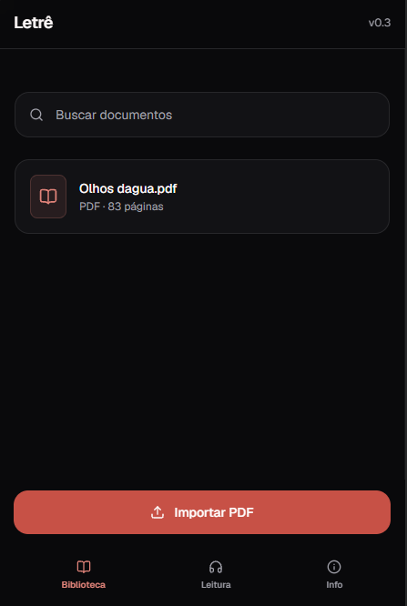
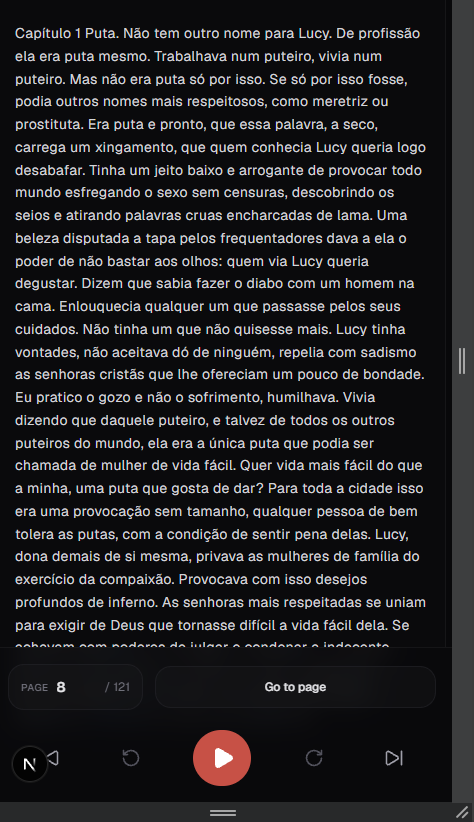

# Letrê

Um leitor de documentos digitais desenvolvido com foco em acessibilidade, personalização e conforto durante a leitura.

## Sobre o projeto

O Letrê é uma aplicação web que permite importar e visualizar documentos PDF em uma interface simples e intuitiva. O projeto busca tornar a leitura digital mais confortável, com recursos de navegação e personalização.

## Prévia do projeto

### Biblioteca

### Leitura

## Tecnologias utilizadas

- **Next.js** — estrutura da aplicação com App Router.
- **TypeScript** — tipagem estática.
- **Tailwind CSS** — estilização da interface.
- **Zustand** — gerenciamento de estado.
- **Lucide React** — biblioteca de ícones.
- **PDF.js** — processamento de documentos PDF.

## Funcionalidades

- Importação e organização de documentos PDF.
- Visualização de documentos em uma interface integrada.
- Navegação entre páginas.
- Leitura de texto com síntese de voz.
- Configurações para personalizar a experiência de leitura.
- Interface responsiva para diferentes dispositivos.

## Desenvolvido por

**João Paulo**

Projeto de portfólio desenvolvido para praticar Next.js, TypeScript e desenvolvimento front-end.

---

_One commit at a time._
